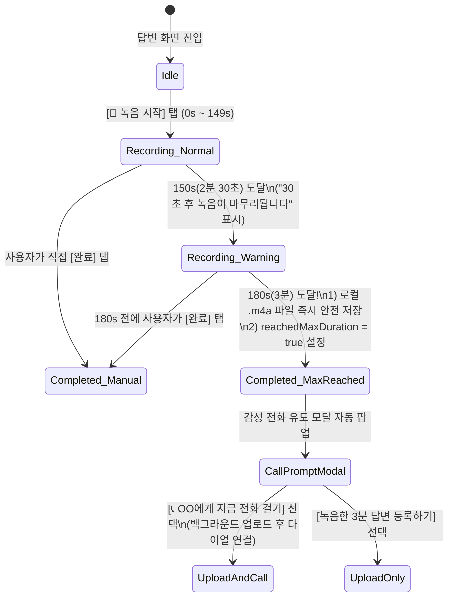
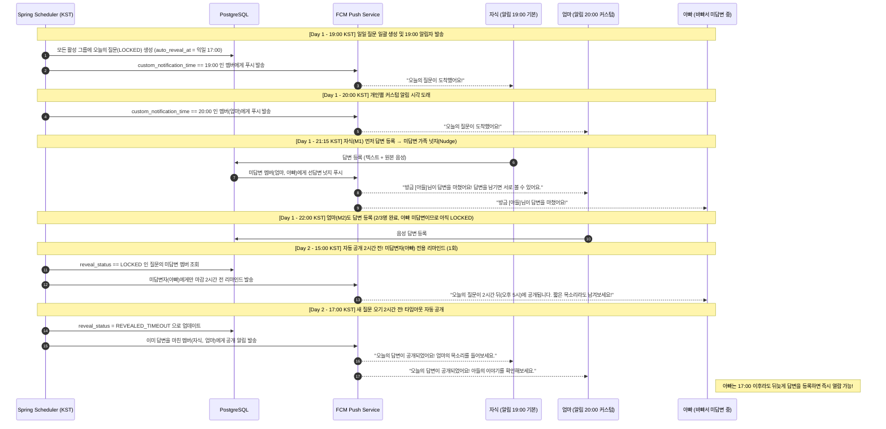

# ARCHITECTURE.md — 시스템 아키텍처 및 상세 기술 설계

본 문서는 **이음(Ieum)** 프로젝트의 전체 시스템 구성, 백엔드(Spring Boot 3 / Java 21)와 클라이언트(Flutter / Riverpod) 레이어링, 음성 파이프라인(온디바이스 STT/TTS + 원본 음성 녹음 전달 + 3분 감성 모달), 그리고 스케줄러 설계를 다룹니다.

---

## 1. 전체 시스템 아키텍처 다이어그램

모든 클라우드 인프라는 **서울 리전(`ap-northeast-2`)**으로 통일하여 지연 시간(Latency)을 최소화하고 국내 개인정보보호법을 준수합니다.

```mermaid
flowchart TB
    subgraph Client["Mobile App (Flutter - iOS / Android)"]
        UI["Presentation Layer\n(Senior Accessibility UI, Riverpod)"]
        VoiceEngine["On-Device Voice Engine\n(speech_to_text / flutter_tts / record)"]
        LocalStore["Local Storage\n(Downloaded .m4a Archive, Drafts)"]
    end

    subgraph AuthProviders["OAuth2 Providers"]
        Kakao["Kakao Login"]
        Naver["Naver Login"]
        Apple["Apple Sign-In"]
    end

    subgraph AWS_Seoul["AWS Seoul Region (ap-northeast-2)"]
        API["Backend API Server\n(Java 21 + Spring Boot 3.3)"]
        Scheduler["Spring Scheduler + ShedLock\n(19:00 질문 / 15:00 리마인드 / 17:00 공개 / 10:00 만료)"]
        DB[("PostgreSQL 16\n(RDS)")]
        Redis[("Redis 7\n(JWT Refresh Token & 초대코드 Rate Limit)")]
        S3[("AWS S3 Bucket\n(30일 Lifecycle + Presigned URL)")]
    end

    FCM["Firebase Cloud Messaging (FCM)"]

    UI -->|1. OAuth 토큰 전달| API
    API -->|2. 토큰 검증| AuthProviders
    UI -->|3. REST API (JWT)| API
    API --> DB
    API --> Redis
    Scheduler --> DB
    API -->|4. Presigned PUT/GET URL 발급| S3
    UI ==>|5. 원본 음성(.m4a) 직접 업로드 / 다운로드| S3
    UI -->|6. 내 폰에 영구 저장| LocalStore
    API -->|7. 푸시 알림 트리거| FCM
    Scheduler -->|8. 시간별 알림/넛지 트리거| FCM
    FCM -.->|푸시 수신| UI
```

---

## 2. 클라이언트 아키텍처 (`mobile/` — Flutter)

### 2.1 상태관리 및 아키텍처 선정 근거
- **상태관리: Riverpod (`flutter_riverpod` + `riverpod_generator`)**
  - **선정 근거**:
    1. 컴파일 타임 안정성 및 `AsyncNotifier`를 통한 비동기 상태(로딩, 에러, 재시도) 처리의 간결함.
    2. **다중 그룹 전환(`currentGroupIdProvider`)**이나 **부모 세대 접근성 설정(`accessibilityConfigProvider`)**이 변경될 때 의존하는 하위 화면과 API 상태를 반응형(Reactive)으로 즉시 갱신하기에 가장 적합함.
    3. 온디바이스 STT/TTS 구현체를 추후 클라우드 구현체로 교체할 때 Provider Override 만으로 손쉽게 의존성 주입(DI) 전환 가능.
- **레이어 구조: Feature-first Layered Architecture**
  - 1인 개발 시 파일 탐색 비용을 줄이기 위해 도메인 기능(`auth`, `group`, `daily_question`, `answer`, `archive`, `settings`)을 최상위 폴더로 나누고, 각 기능 내부를 `presentation`(Widget, Notifier), `domain`(Entity, Service Interface), `data`(Repository, DTO, DataSource)로 구성합니다.

### 2.2 주요 Flutter 패키지 선정 목록
| 분류 | 패키지명 | 선정 이유 및 용도 |
| :--- | :--- | :--- |
| **상태관리/DI** | `flutter_riverpod`, `riverpod_annotation` | 선언적 상태관리 및 서비스 추상화 주입 |
| **라우팅/딥링크** | `go_router` | 카카오톡 초대 딥링크(`ieum://invite?code=...`) 처리 및 인증 가드 |
| **네트워크** | `dio`, `retrofit` (선택) | JWT 자동 갱신 인터셉터 및 S3 Presigned URL 바이너리 PUT/GET |
| **음성 녹음(원본)** | `record` | iOS/Android 공통 `AAC-LC (.m4a), 64kbps, 22.05kHz/44.1kHz, Mono` 하드웨어 인코딩 지원 |
| **음성 재생** | `just_audio`, `audio_session` | S3 스트리밍 재생 및 로컬 다운로드 파일 재생, 통화/무음 모드 오디오 세션 제어 |
| **온디바이스 STT** | `speech_to_text` | 추가 API 과금 없이 실시간 음성→텍스트 스트리밍 변환 |
| **온디바이스 TTS** | `flutter_tts` | 한국어 음성 합성(질문 읽어주기) 및 말하기 속도(`0.8x ~ 1.0x`) 제어 |
| **전화 연결** | `url_launcher` | 3분 녹음 도달 시 `tel:010xxxxxxxx` 스키마로 부모님/자식에게 즉시 전화 연결 |
| **로컬 파일 저장** | `path_provider`, `share_plus` | 30일 서버 만료 전 원본 음성을 내 스마트폰에 영구 다운로드 및 공유 |

---

## 3. 음성 파이프라인 상세 설계 (STT + TTS + 원본 음성 + 3분 감성 UX)

### 3.1 STT / TTS 인터페이스 추상화 (클라우드 확장 대비)
v1에서는 호출 요금이 0원인 온디바이스 엔진(`A안`)을 사용하지만, 향후 프리미엄 유저에게 고품질 클라우드 엔진(`B안`: OpenAI Whisper, CLOVA Voice)을 제공할 수 있도록 아래와 같이 추상화합니다.

```dart
// lib/core/voice/stt_service.dart
abstract interface class SttService {
  Future<bool> initialize();
  Stream<SttRecognitionResult> startListening({Duration maxDuration});
  Future<void> stopListening();
}

// v1 기본 주입: OnDeviceSttService (speech_to_text 기반)
// 향후 유료 플랜 주입: WhisperCloudSttService (녹음된 .m4a를 기반으로 고정밀 변환)
```

### 3.2 "STT 텍스트 변환"과 "원본 음성 전달"의 결합 파이프라인
사용자가 **"원본 녹음도 가족에게 그대로 전달하고, 동시에 텍스트로도 읽히게 하고 싶은"** 니즈를 만족시키기 위해 두 가지 모드를 직관적으로 지원합니다.

1. **원본 음성 + 텍스트 동시 기록 플로우 (기본 권장)**:
   - 사용자가 `[🎤 내 목소리로 답하기]` 버튼을 누르면 로컬에서 `record` 패키지가 `.m4a (64kbps, mono)` 녹음을 시작하고, 동시에 보조로 STT 텍스트 캡처를 수행(또는 녹음 완료 후 텍스트 한 줄 메모 추가 가능).
   - 답변 등록 시:
     1. 백엔드에 `POST /api/v1/groups/{groupId}/questions/{dqId}/audio-upload-url` 요청 → `presignedPutUrl` 및 `audioObjectKey` 획득.
     2. 클라이언트가 S3로 `.m4a` 파일을 직접 `PUT` 업로드.
     3. 백엔드에 `POST /api/v1/groups/{groupId}/questions/{dqId}/answers`로 `textContent`, `sttRawText`, `audioObjectKey`, `audioDurationSec`을 함께 저장.
2. **원본 음성 전용 모드**:
   - 글자 수정조차 번거로운 부모님은 녹음 시작 → 종료 → `[목소리 바로 보내기]` 버튼만 누르면 텍스트 입력 없이 원본 음성만으로 답변이 완료됨.

### 3.3 3분(180초) 제한 타이머 상태 머신 및 감성 전화 유도 플로우



- **핵심 UX 디테일**: 3분이 초과되었다고 해서 녹음 파일이 날아가거나 딱딱한 경고창이 뜨면 절대 안 됩니다. **3분까지의 목소리는 100% 안전하게 보존**한 상태에서, *"오늘은 이 질문에 대해 나누고 싶은 이야기가 많은가 봐요. 오늘 밤은 [엄마]에게 전화해서 목소리를 들으며 이 이야기를 나눠보는 것은 어떨까요?"*라는 메시지로 자연스럽게 실제 통화로 이어지게 합니다.

---

## 4. 일일 질문 & 타임아웃 자동 공개 & 개인별 알림 스케줄러 설계

모든 그룹의 질문 생성 시각은 **매일 오후 7시(19:00 KST)**로 고정되어 있으며, 하루의 질문 사이클은 **당일 19:00 ~ 익일 19:00 (24시간)**으로 돌아갑니다.

### 4.1 24시간 타임라인 흐름도 (Daily Cycle Timeline)



### 4.2 스케줄러 Job 목록 (Spring `@Scheduled`)
1. `DailyQuestionAssignJob` (`cron = "0 0 19 * * *"`, `zone = "Asia/Seoul"`):
   - 매일 19:00 정각에 모든 활성 그룹에 새 질문을 배정하고 `auto_reveal_at`을 익일 `17:00 KST`로 설정합니다.
2. `CustomNotificationDispatchJob` (`cron = "0 */15 * * * *"`, `zone = "Asia/Seoul"`):
   - 15분 단위로 실행되며, 현재 시각과 `group_members.custom_notification_time`이 일치하는 멤버들에게 오늘의 질문 도착 푸시를 발송합니다.
3. `PreRevealReminderJob` (`cron = "0 0 15 * * *"`, `zone = "Asia/Seoul"`):
   - 매일 오후 3시(자동 공개 시각인 오후 5시의 2시간 전), 당일 질문에 아직 답변하지 않은 멤버에게만 리마인드 푸시를 1회 발송합니다.
4. `TimeoutAutoRevealJob` (`cron = "0 0 17 * * *"`, `zone = "Asia/Seoul"`):
   - 매일 오후 5시(새 질문이 오기 2시간 전), 아직 `LOCKED` 상태이면서 최소 1명 이상 답변이 존재하는 질문을 `REVEALED_TIMEOUT`으로 전환하고 답변 완료자들에게 공개 푸시를 발송합니다.
5. `AudioLifecycleCleanupJob` (`cron = "0 0 10 * * *"`, `zone = "Asia/Seoul"`):
   - 매일 오전 10시, 원본 음성 만료 7일 전(`D-7`) 사전 다운로드 안내 푸시 발송 및 30일 경과 음성의 DB 상태(`EXPIRED_DELETED`) 업데이트를 수행합니다.

---

## 5. 향후 유료화(Premium) 전환을 고려한 Feature Entitlement 아키텍처

초기 v1에서는 원본 음성 전달을 포함한 모든 핵심 기능을 무료로 제공하지만, 추후 코드 수정이나 강제 업데이트를 최소화하면서 유료 요금제(프리미엄)를 도입할 수 있도록 **서버 주도형 권한 정책(Server-Driven Entitlement Policy)** 구조를 채택합니다.

```java
// com.ieum.backend.domain.entitlement.dto.FeatureEntitlementResponse
public record FeatureEntitlementResponse(
    String currentPlan,                  // "FREE" | "PREMIUM"
    boolean canAttachOriginalVoice,      // v1: FREE에서도 true 반환 (향후 유료 전환 시 서버 설정만으로 제어 가능)
    int maxVoiceDurationSeconds,         // FREE: 180 (3분), PREMIUM: 600 (10분)
    int voiceServerRetentionDays,        // FREE: 30 (30일 후 자동 삭제), PREMIUM: 36500 (영구 보관)
    boolean canDownloadVoiceToLocal,     // true (30일 만료 전 내 폰 저장 허용)
    String sttEngineType                 // FREE: "ON_DEVICE", PREMIUM: "CLOUD_WHISPER"
) {}
```

- 클라이언트는 앱 실행 및 그룹 진입 시 위 정책 객체를 참조하여 UI(녹음 버튼 활성화 여부, 최대 타이머 초수, 보관 기간 안내 문구)를 동적으로 렌더링합니다.
