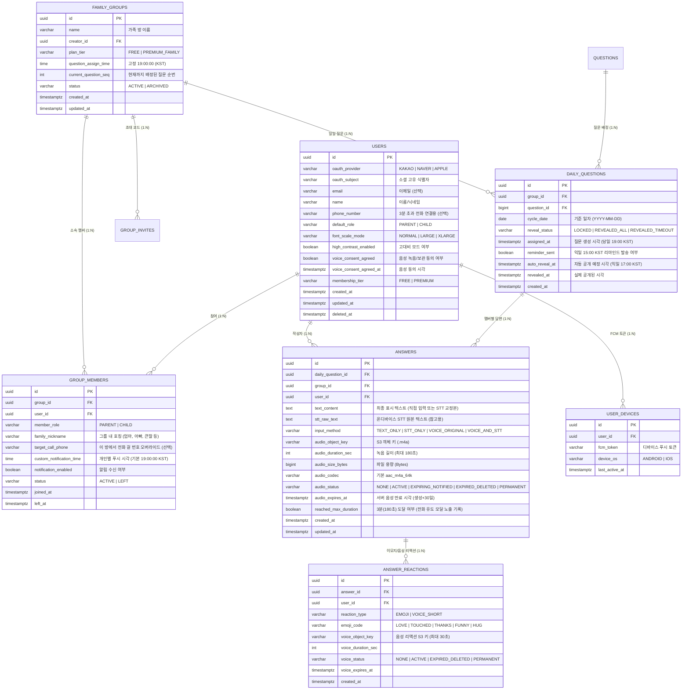

# DATA_MODEL.md — 데이터베이스(PostgreSQL) 및 스토리지(S3) 설계 명세

본 문서는 **Java 21 + Spring Boot 3.3 + PostgreSQL 16 + AWS S3** 기반의 데이터 모델, ERD, DDL 스키마, 그리고 30일 음성 보관 수명주기(Lifecycle) 및 권한 제어 규칙을 정의합니다.

---

## 1. 엔티티 관계도 (ERD Overview)

다중 그룹 참여(`users` N : M `family_groups`), 그룹별 질문 배정(`daily_questions`), 멀티모달 답변(`answers` — 텍스트 + STT + 원본 음성), 그리고 향후 유료화를 대비한 플랜 등급(`users.membership_tier`, `family_groups.plan_tier` 및 서버 주도형 `EntitlementService`)을 중심으로 설계되었습니다.



---

## 2. PostgreSQL 상세 DDL 스키마 (`V1__init_schema.sql` 기준)

```sql
-- UUID 확장 활성화
CREATE EXTENSION IF NOT EXISTS "pgcrypto";

-- 1. 사용자 테이블 (users)
CREATE TABLE users (
    id UUID PRIMARY KEY DEFAULT gen_random_uuid(),
    oauth_provider VARCHAR(20) NOT NULL,           -- 'KAKAO', 'NAVER', 'APPLE'
    oauth_subject VARCHAR(128) NOT NULL,           -- 소셜 고유 ID
    email VARCHAR(255),
    name VARCHAR(50) NOT NULL,
    phone_number VARCHAR(30),                      -- 3분 초과 시 전화 연결용 (암호화 또는 마스킹 관리 권장)
    default_role VARCHAR(20) NOT NULL DEFAULT 'CHILD', -- 'PARENT', 'CHILD'
    font_scale_mode VARCHAR(20) NOT NULL DEFAULT 'NORMAL', -- 'NORMAL', 'LARGE', 'XLARGE'
    high_contrast_enabled BOOLEAN NOT NULL DEFAULT FALSE,
    voice_consent_agreed BOOLEAN NOT NULL DEFAULT FALSE,
    voice_consent_agreed_at TIMESTAMPTZ,
    membership_tier VARCHAR(20) NOT NULL DEFAULT 'FREE', -- 'FREE', 'PREMIUM'
    created_at TIMESTAMPTZ NOT NULL DEFAULT NOW(),
    updated_at TIMESTAMPTZ NOT NULL DEFAULT NOW(),
    deleted_at TIMESTAMPTZ,
    CONSTRAINT uq_users_oauth UNIQUE (oauth_provider, oauth_subject)
);

-- 2. 가족 그룹 테이블 (family_groups)
CREATE TABLE family_groups (
    id UUID PRIMARY KEY DEFAULT gen_random_uuid(),
    name VARCHAR(100) NOT NULL,                    -- 예: '사랑하는 우리 가족', '시댁 소통방'
    creator_id UUID NOT NULL REFERENCES users(id),
    plan_tier VARCHAR(30) NOT NULL DEFAULT 'FREE', -- 'FREE', 'PREMIUM_FAMILY' (향후 유료화 확장용)
    question_assign_time TIME NOT NULL DEFAULT '19:00:00', -- KST 오후 7시 고정
    current_question_seq INT NOT NULL DEFAULT 0,
    status VARCHAR(20) NOT NULL DEFAULT 'ACTIVE',  -- 'ACTIVE', 'ARCHIVED'
    created_at TIMESTAMPTZ NOT NULL DEFAULT NOW(),
    updated_at TIMESTAMPTZ NOT NULL DEFAULT NOW()
);

-- 3. 그룹 멤버십 테이블 (group_members) - 다중 그룹 N:M 매핑 및 개인별 알림 시각
CREATE TABLE group_members (
    id UUID PRIMARY KEY DEFAULT gen_random_uuid(),
    group_id UUID NOT NULL REFERENCES family_groups(id) ON DELETE CASCADE,
    user_id UUID NOT NULL REFERENCES users(id) ON DELETE CASCADE,
    member_role VARCHAR(20) NOT NULL,              -- 'PARENT', 'CHILD'
    family_nickname VARCHAR(40) NOT NULL,          -- 그룹 내 표시 호칭 (예: '엄마', '아빠', '막내아들')
    target_call_phone VARCHAR(30),                 -- 이 방에서 전화 걸 번호 오버라이드 (선택, 미지정 시 users.phone_number 사용)
    custom_notification_time TIME NOT NULL DEFAULT '19:00:00', -- KST 기준 개인별 푸시 시각 (기본값 19:00:00)
    notification_enabled BOOLEAN NOT NULL DEFAULT TRUE,
    status VARCHAR(20) NOT NULL DEFAULT 'ACTIVE',  -- 'ACTIVE', 'LEFT'
    joined_at TIMESTAMPTZ NOT NULL DEFAULT NOW(),
    left_at TIMESTAMPTZ,
    CONSTRAINT uq_group_member UNIQUE (group_id, user_id)
);

CREATE INDEX idx_group_members_notify_time ON group_members(custom_notification_time) WHERE status = 'ACTIVE' AND notification_enabled = TRUE;

-- 4. 그룹 초대 코드 테이블 (group_invites)
CREATE TABLE group_invites (
    id UUID PRIMARY KEY DEFAULT gen_random_uuid(),
    group_id UUID NOT NULL REFERENCES family_groups(id) ON DELETE CASCADE,
    inviter_id UUID NOT NULL REFERENCES users(id),
    invite_code CHAR(6) NOT NULL UNIQUE,           -- 6자리 숫자 초대코드 (예: '842910', 정규식 ^[0-9]{6}$ 검증)
    expires_at TIMESTAMPTZ NOT NULL,
    is_active BOOLEAN NOT NULL DEFAULT TRUE,
    created_at TIMESTAMPTZ NOT NULL DEFAULT NOW(),
    CONSTRAINT chk_invite_code_digits CHECK (invite_code ~ '^[0-9]{6}$')
);

-- 5. 질문 은행 마스터 테이블 (questions)
CREATE TABLE questions (
    id BIGSERIAL PRIMARY KEY,
    sequence_order INT NOT NULL UNIQUE,            -- 기본 배정 순서 (Day 1, Day 2...)
    category VARCHAR(30) NOT NULL,                 -- 'MEMORY'(추억), 'DAILY'(일상), 'VALUE'(가치관), 'GRATITUDE'(감사), 'YOUTH'(젊은시절)
    question_text TEXT NOT NULL,                   -- 질문 본문
    tts_guide_text TEXT,                           -- TTS 발음 자연스러움을 위한 보조 스크립트 (선택)
    follow_up_hint TEXT,                           -- 부모님이 대답하기 쉽게 돕는 힌트 문구
    is_active BOOLEAN NOT NULL DEFAULT TRUE,
    created_at TIMESTAMPTZ NOT NULL DEFAULT NOW()
);

-- 6. 그룹별 일일 배정 질문 테이블 (daily_questions)
CREATE TABLE daily_questions (
    id UUID PRIMARY KEY DEFAULT gen_random_uuid(),
    group_id UUID NOT NULL REFERENCES family_groups(id) ON DELETE CASCADE,
    question_id BIGINT NOT NULL REFERENCES questions(id),
    cycle_date DATE NOT NULL,                      -- 질문 기준 날짜 (KST 19:00 생성 기준일)
    reveal_status VARCHAR(30) NOT NULL DEFAULT 'LOCKED', -- 'LOCKED', 'REVEALED_ALL', 'REVEALED_TIMEOUT'
    assigned_at TIMESTAMPTZ NOT NULL,              -- 당일 19:00 KST
    reminder_sent BOOLEAN NOT NULL DEFAULT FALSE,  -- 익일 15:00 KST (마감 2시간 전) 리마인드 발송 여부
    auto_reveal_at TIMESTAMPTZ NOT NULL,           -- 익일 17:00 KST (새 질문 2시간 전 자동 공개 시각)
    revealed_at TIMESTAMPTZ,
    created_at TIMESTAMPTZ NOT NULL DEFAULT NOW(),
    CONSTRAINT uq_daily_question_group_date UNIQUE (group_id, cycle_date),
    CONSTRAINT uq_daily_question_id_group UNIQUE (id, group_id)
);

CREATE INDEX idx_daily_questions_auto_reveal ON daily_questions(reveal_status, auto_reveal_at) WHERE reveal_status = 'LOCKED';

-- 7. 답변 테이블 (answers) - 텍스트 + STT + 원본 음성 통합 관리
-- NOTE (TODO Premium): v1은 FREE 플랜(최대 180초, 3MB)만 활성화하므로 chk_audio_duration <= 180으로 강제합니다.
-- 향후 PREMIUM(600초) 플랜 결제 오픈 시 Flyway 후속 마이그레이션(V{n}__expand_premium_audio_duration.sql)으로 CHECK 상한을 600초로 확장합니다.
CREATE TABLE answers (
    id UUID PRIMARY KEY DEFAULT gen_random_uuid(),
    daily_question_id UUID NOT NULL,
    group_id UUID NOT NULL REFERENCES family_groups(id) ON DELETE CASCADE,
    user_id UUID NOT NULL REFERENCES users(id),
    text_content TEXT,                             -- 화면에 표시될 텍스트 답변 (직접 입력 또는 STT 변환본)
    stt_raw_text TEXT,                             -- 온디바이스 STT 초기 인식 원문
    input_method VARCHAR(30) NOT NULL,             -- 'TEXT_ONLY', 'STT_ONLY', 'VOICE_ORIGINAL', 'VOICE_AND_STT'
    
    -- 원본 음성 녹음 관련 메타데이터
    audio_object_key VARCHAR(512),                 -- S3 Object Key (예: audio/ephemeral-30d/groups/{groupId}/...)
    audio_duration_sec INT,                        -- 녹음 시간 (v1 FREE 기준 1 ~ 180초)
    audio_size_bytes BIGINT,                       -- 파일 크기
    audio_codec VARCHAR(30) DEFAULT 'aac_m4a_64k',
    audio_status VARCHAR(30) NOT NULL DEFAULT 'NONE', -- 'NONE', 'ACTIVE', 'EXPIRING_NOTIFIED', 'EXPIRED_DELETED', 'PERMANENT'
    audio_expires_at TIMESTAMPTZ,                  -- 무료 기본: 생성 시각 + 30일
    reached_max_duration BOOLEAN NOT NULL DEFAULT FALSE, -- 180초 도달하여 감성 전화 유도 모달이 떴는지 여부
    
    created_at TIMESTAMPTZ NOT NULL DEFAULT NOW(),
    updated_at TIMESTAMPTZ NOT NULL DEFAULT NOW(),
    CONSTRAINT fk_answers_daily_question_group FOREIGN KEY (daily_question_id, group_id)
        REFERENCES daily_questions(id, group_id) ON DELETE CASCADE,
    CONSTRAINT uq_answer_per_user UNIQUE (daily_question_id, user_id),
    CONSTRAINT chk_audio_duration CHECK (audio_duration_sec IS NULL OR (audio_duration_sec >= 1 AND audio_duration_sec <= 180))
);

CREATE INDEX idx_answers_audio_lifecycle ON answers(audio_status, audio_expires_at) WHERE audio_status IN ('ACTIVE', 'EXPIRING_NOTIFIED');

-- 8. 리액션 테이블 (answer_reactions)
CREATE TABLE answer_reactions (
    id UUID PRIMARY KEY DEFAULT gen_random_uuid(),
    answer_id UUID NOT NULL REFERENCES answers(id) ON DELETE CASCADE,
    user_id UUID NOT NULL REFERENCES users(id) ON DELETE CASCADE,
    reaction_type VARCHAR(20) NOT NULL,            -- 'EMOJI', 'VOICE_SHORT'
    emoji_code VARCHAR(30),                        -- 'LOVE', 'TOUCHED', 'THANKS', 'FUNNY', 'HUG'
    voice_object_key VARCHAR(512),                 -- 짧은 음성 리액션 S3 키 (최대 30초)
    voice_duration_sec INT,
    voice_status VARCHAR(30) NOT NULL DEFAULT 'NONE', -- 'NONE', 'ACTIVE', 'EXPIRED_DELETED', 'PERMANENT'
    voice_expires_at TIMESTAMPTZ,
    created_at TIMESTAMPTZ NOT NULL DEFAULT NOW(),
    CONSTRAINT chk_reaction_voice_duration CHECK (voice_duration_sec IS NULL OR (voice_duration_sec >= 1 AND voice_duration_sec <= 30))
);

-- 9. 푸시 알림용 디바이스 토큰 테이블 (user_devices)
CREATE TABLE user_devices (
    id UUID PRIMARY KEY DEFAULT gen_random_uuid(),
    user_id UUID NOT NULL REFERENCES users(id) ON DELETE CASCADE,
    fcm_token VARCHAR(512) NOT NULL,
    device_os VARCHAR(20) NOT NULL,                -- 'ANDROID', 'IOS'
    last_active_at TIMESTAMPTZ NOT NULL DEFAULT NOW(),
    CONSTRAINT uq_user_fcm_token UNIQUE (user_id, fcm_token)
);

-- 10. 분산 스케줄러 중복 실행 방지 락 테이블 (shedlock)
CREATE TABLE shedlock (
    name VARCHAR(64) NOT NULL PRIMARY KEY,
    lock_until TIMESTAMPTZ NOT NULL,
    locked_at TIMESTAMPTZ NOT NULL,
    locked_by VARCHAR(255) NOT NULL
);
```

---

## 3. AWS S3 스토리지 경로 설계 및 30일 자동 삭제(Lifecycle) 정책

### 3.1 S3 버킷 및 리전
- **리전**: `ap-northeast-2` (서울)
- **버킷명**: `ieum-voice-storage-prod` (로컬/개발: `ieum-voice-storage-local`, 테스트: `ieum-voice-storage-test`)

### 3.2 S3 Object Key (경로) 규칙 — 무료/유료 분리 설계
S3의 **Object Lifecycle Rule(수명주기 규칙)**은 프리픽스(경로 앞부분) 또는 객체 태그(Object Tagging)를 기준으로 동작합니다. 서버 부하 없이 S3가 알아서 30일 지난 무료 음성을 삭제하도록 **프리픽스를 분리**합니다.

1. **무료(30일 보관 후 자동 삭제) 원본 음성 경로**:
   - 답변 음성: `audio/ephemeral-30d/groups/{groupId}/questions/{dailyQuestionId}/answers/{userId}_{uuid}.m4a`
   - 리액션 음성: `audio/ephemeral-30d/groups/{groupId}/questions/{dailyQuestionId}/reactions/{userId}_{uuid}.m4a`
2. **프리미엄(영구 보관 — 향후 유료 해금 시) 원본 음성 경로**:
   - 답변 음성: `audio/permanent/groups/{groupId}/questions/{dailyQuestionId}/answers/{userId}_{uuid}.m4a`

> **💡 유료 전환 시 동작 방식**: 무료 그룹이 추후 프리미엄으로 업그레이드하면, 아직 만료되지 않은(`ACTIVE`) `audio/ephemeral-30d/...` 객체들을 S3 `CopyObject` API로 `audio/permanent/...`로 이동시키고 `audio_status = 'PERMANENT'`, `audio_expires_at = NULL`로 업데이트합니다.

### 3.3 S3 Lifecycle 구성 및 백엔드 배치 동기화
1. **S3 Lifecycle Rule (`rule-expire-free-audio-30d`)**:
   - 대상 Prefix: `audio/ephemeral-30d/`
   - 동작: 객체 생성 후 **31일 차(`Expiration: 31 days`)**에 S3에서 물리적 자동 삭제. (애플리케이션에서는 30일 시점부터 만료 처리하여 경계 시점 404 에러 방지)
2. **백엔드 일일 배치 스케줄러 (매일 오전 10:00 KST 실행)**:
   - **D-7 사전 알림 배치**: `audio_expires_at`이 현재로부터 7일 이내로 남았고 `audio_status = 'ACTIVE'`인 답변을 찾아 그룹 멤버들에게 *"일주일 뒤 [날짜]의 목소리 원본이 보관함에서 정리됩니다. 앱에서 내 휴대폰에 저장해 두세요!"* 푸시 발송 후 `audio_status = 'EXPIRING_NOTIFIED'`로 변경.
   - **D-Day 만료 상태 동기화 배치**: `audio_expires_at <= NOW()`인 답변의 `audio_status`를 `'EXPIRED_DELETED'`로 변경. (이때 **`text_content`와 `stt_raw_text`는 절대 삭제하지 않고 그대로 유지**하여 텍스트 타임라인은 영구 보존)

---

## 4. 데이터 접근 제어 및 보안 규칙 (Application-Level Security)

Firebase와 달리 Spring Boot 백엔드가 모든 DB 및 S3 접근 권한을 통제합니다.

1. **다중 그룹 격리 검증 (`@GroupMemberOnly`)**:
   - 모든 `/api/v1/groups/{groupId}/...` 엔드포인트는 요청한 `userId`가 해당 `groupId`에 `status = 'ACTIVE'`로 소속된 멤버인지 검증합니다.
2. **답변 열람 잠금 제어 (서버 사이드 마스킹)**:
   - `daily_questions.reveal_status == 'LOCKED'`인 동안에는, API 응답에서 **본인이 작성한 답변 외의 다른 가족 답변의 `text_content`와 `audio_object_key(Presigned GET URL)`를 `null`로 마스킹**하고 `"hasAnswered": true, "familyNickname": "엄마"` 정도의 상태만 내려줍니다. (클라이언트 변조로 미리 훔쳐보는 것 원천 차단)
   - `reveal_status == 'REVEALED_TIMEOUT'`(익일 오후 5시 자동 공개) 상태일 때는, **본인이 답변을 완료한 멤버(`hasCurrentUserAnswered == true`)에게만** 다른 가족의 답변 본문과 음성 URL을 내려줍니다.
3. **S3 Presigned URL 보안**:
   - S3 버킷은 `Block all public access = ON`으로 완전 비공개 설정합니다.
   - 업로드용 `Presigned PUT URL`은 발급 요청 시 클라이언트가 전달한 `fileSizeBytes`(최대 `3,145,728 Bytes = 3MB` 이하 검증)와 `Content-Type: audio/mp4`를 `PutObjectRequest.contentLength(fileSizeBytes).contentType("audio/mp4")`로 서명에 고정하며(만료 시간 **10분**), 답변 최종 등록 시 서버에서 S3 `HeadObject`로 실제 업로드된 파일 용량과 메타데이터를 2차 검증합니다.
   - 재생/다운로드용 `Presigned GET URL`은 위 2번의 공개 조건을 통과한 요청에 한해 만료 시간 **1시간**짜리 임시 URL로 발급합니다.
